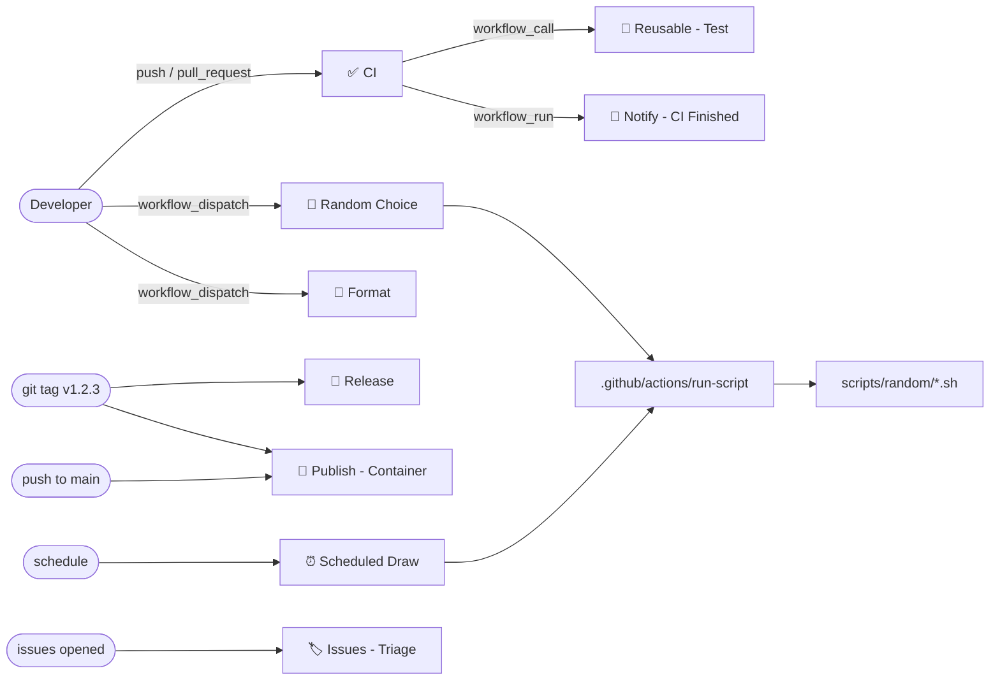

# 🎲 GitHub Actions Playground

[](https://github.com/HarryVasanth/gdg-madeira-github-actions/actions/workflows/ci.yml)
[](https://github.com/HarryVasanth/gdg-madeira-github-actions/actions/workflows/random-choice.yml)

Example repository for the **GDG Madeira** talk on GitHub Actions (28 March
2024). It stays small on purpose, but nothing here is fake: every workflow runs,
every shell script passes ShellCheck, and every job declares the token
permissions it actually needs.

- 📉 **No `write-all`** and no `pull_request_target`.
- 🧩 **Reusable pieces**: one reusable workflow, one composite action.
- 🔐 **Secure by default**: CodeQL, dependency review, Dependabot.
- 📝 **Docs that render**: Mermaid diagrams, a cookbook, and a Pages site.

## How it fits together



More diagrams, including the permission model and the release sequence, live in
[`docs/architecture.md`](docs/architecture.md).

## Workflows

| Workflow                                                           | Trigger                      | What it demonstrates                              |
| ------------------------------------------------------------------ | ---------------------------- | ------------------------------------------------- |
| [`ci.yml`](.github/workflows/ci.yml)                               | push, PR, merge queue        | matrix, reusable workflow, concurrency, summary   |
| [`reusable-test.yml`](.github/workflows/reusable-test.yml)         | `workflow_call`              | shared checks, artifacts, pinned tooling          |
| [`random-choice.yml`](.github/workflows/random-choice.yml)         | `workflow_dispatch` (choice) | dispatch inputs, composite action, job summary    |
| [`format.yml`](.github/workflows/format.yml)                       | `workflow_dispatch`          | write-back bot commit without third-party actions |
| [`release.yml`](.github/workflows/release.yml)                     | tag `v*.*.*`                 | generated release notes with `gh`                 |
| [`publish-image.yml`](.github/workflows/publish-image.yml)         | push to `main`, tag, manual  | GHCR login, Buildx, metadata, cache               |
| [`codeql.yml`](.github/workflows/codeql.yml)                       | push, PR, weekly cron        | CodeQL for the `actions` language                 |
| [`dependency-review.yml`](.github/workflows/dependency-review.yml) | pull request                 | fail on high-severity dependencies                |
| [`docs.yml`](.github/workflows/docs.yml)                           | push to `docs/`, manual      | Pages artifact, environment, OIDC                 |
| [`issue-triage.yml`](.github/workflows/issue-triage.yml)           | issues opened                | `actions/github-script`, issue permissions        |
| [`schedule.yml`](.github/workflows/schedule.yml)                   | daily cron, manual           | scheduled runs and shared composite action        |
| [`workflow-run.yml`](.github/workflows/workflow-run.yml)           | CI completed                 | chaining workflows with `workflow_run`            |
| [`event-mirror.yml`](.github/workflows/event-mirror.yml)           | many events                  | what each event payload carries                   |

The full event matrix, including the events that are deliberately not used, is
in [`docs/example-workflows.md`](docs/example-workflows.md).

## Try it locally

```bash
bash scripts/random/card.sh
bash scripts/random/dice.sh
bash scripts/random/coin.sh
bash scripts/test/smoke.sh
```

To exercise the workflows, open **Actions** and run **🎲 Random Choice** or
**💄 Format - Prettier**. To exercise the release path:

```bash
git tag v1.0.0
git push origin v1.0.0
```

## Security

The short version: least-privilege tokens, no `pull_request_target`, no
interpolated event data in `run:` blocks, and no third-party actions in the
release path. The full policy, plus how to SHA-pin actions, is in
[`SECURITY.md`](SECURITY.md).

Dependabot watches the `github-actions` and `docker` ecosystems every week, so
the pins do not rot.

## Version policy

The talk happened on 2024-03-28, so the workflows use the latest action majors
that existed that day (`checkout@v4`, `setup-node@v4`, `upload-artifact@v4`,
`codeql-action@v3`, `docker/*@v3`/`v5`). Newer majors exist today; the point of
the repository is the pattern, not the version number. Dependabot is the upgrade
path.

## Docs

- [Architecture](docs/architecture.md) — layout, trigger map, permission model.
- [Workflow cookbook](docs/example-workflows.md) — use cases and event coverage.
- [Presentation](docs/presentation.pdf) — the original slides.
- [Security policy](SECURITY.md) — reporting and hardening notes.

## License

[AGPL-3.0](LICENSE).
