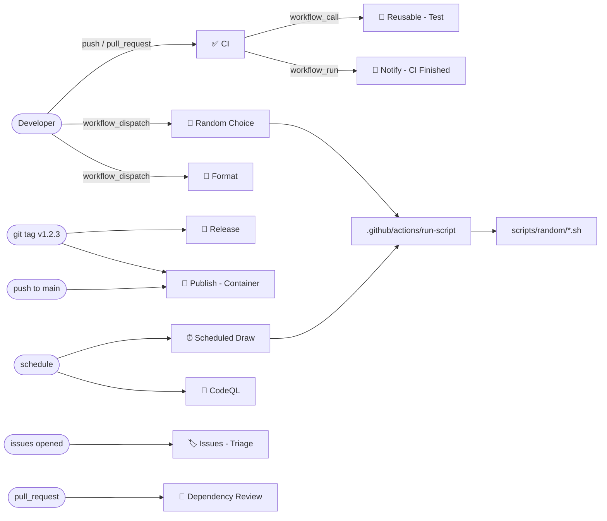
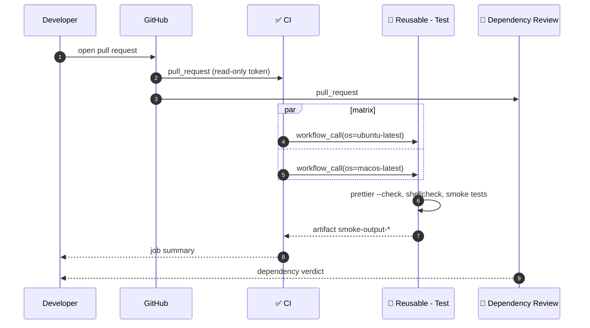
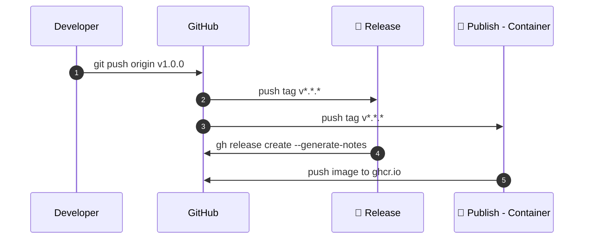

# 🏗️ Architecture

The repository is deliberately small, but it is split the way a real automation
repository should be: workflows orchestrate, composite actions wrap repeated
steps, scripts hold the logic, and docs explain the whole thing.

## Layout

```text
.github/
├── actions/run-script/action.yml   # composite action, validated input
├── dependabot.yml                  # weekly action + image updates
└── workflows/
    ├── ci.yml                      # PR / push / merge queue entry point
    ├── reusable-test.yml           # workflow_call, the actual checks
    ├── format.yml                  # manual write-back formatter
    ├── release.yml                 # tag -> GitHub Release
    ├── publish-image.yml           # main + tags -> GHCR
    ├── codeql.yml                  # CodeQL for the `actions` language
    ├── dependency-review.yml       # PR dependency gate
    ├── docs.yml                    # docs/ -> GitHub Pages
    ├── issue-triage.yml            # issues -> github-script
    ├── schedule.yml                # daily cron
    ├── workflow-run.yml            # chained CI completion report
    └── event-mirror.yml            # broad event coverage demo
scripts/
├── random/{card,dice,coin}.sh      # bash, set -euo pipefail
└── test/smoke.sh                   # assert-based checks
docs/                               # Pages site + talk material
```

## Trigger to workflow map



## Pull request flow



## Release flow



## Permission model

| Workflow                | contents | packages | pages | id-token | security-events | issues | pull-requests | actions |
| ----------------------- | -------- | -------- | ----- | -------- | --------------- | ------ | ------------- | ------- |
| `ci.yml`                | read     | –        | –     | –        | –               | –      | –             | –       |
| `reusable-test.yml`     | read     | –        | –     | –        | –               | –      | –             | –       |
| `format.yml`            | write    | –        | –     | –        | –               | –      | –             | –       |
| `release.yml`           | write    | –        | –     | –        | –               | –      | –             | –       |
| `publish-image.yml`     | read     | write    | –     | –        | –               | –      | –             | –       |
| `docs.yml`              | read     | –        | write | write    | –               | –      | –             | –       |
| `codeql.yml`            | read     | read     | –     | –        | write           | –      | –             | read    |
| `dependency-review.yml` | read     | –        | –     | –        | –               | –      | write         | –       |
| `issue-triage.yml`      | read     | –        | –     | –        | –               | write  | –             | –       |
| `workflow-run.yml`      | read     | –        | –     | –        | –               | –      | –             | read    |
| `schedule.yml`          | read     | –        | –     | –        | –               | –      | –             | –       |
| `event-mirror.yml`      | read     | –        | –     | –        | –               | –      | –             | –       |
| `random-choice.yml`     | read     | –        | –     | –        | –               | –      | –             | –       |

Anything not listed defaults to no permission on the `GITHUB_TOKEN`.

## Decisions

| Decision                                 | Why                                                                                            |
| ---------------------------------------- | ---------------------------------------------------------------------------------------------- |
| Reusable workflow for checks             | One definition, called by CI for both operating systems; no copy-pasted steps.                 |
| Composite action for scripts             | The dispatch workflow and the cron job share validated script execution and output handling.   |
| Manual-only formatter                    | A push-triggered formatter commits with a bot token and can loop; manual runs are predictable. |
| `gh release create` instead of an action | One less third-party dependency in the release path.                                           |
| Plain `git` in the formatter             | Same reason: no third-party commit action needs the write token.                               |
| `$RANDOM` in the scripts                 | The scripts are toys; the fairness ceiling is documented in each script.                       |
| No `pull_request_target`                 | It combines a write token with untrusted code. `pull_request` is enough for these checks.      |
| Actions pinned to 2024-03-28 majors      | The talk is a time capsule; Dependabot keeps the pins fresh from here.                         |
